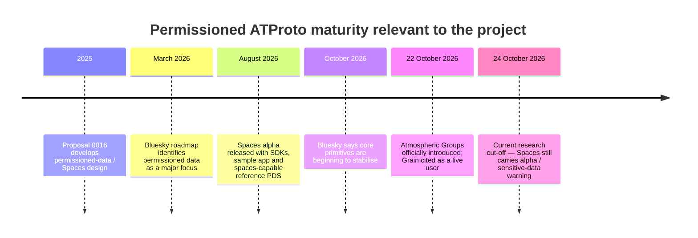
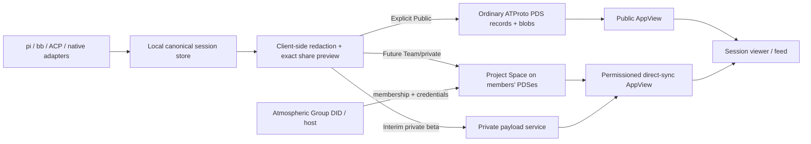

# Social Coding for the AI Age: “Bluesky for Code”

## Executive summary

The research brief defines a product that makes coding-agent sessions portable social objects on AT Protocol: users should be able to share a single session or a project’s sessions, browse team activity, eventually collaborate inside sessions, and preserve company privacy, with **pi** and **bb** as the first harnesses but not the architectural boundary. fileciteturn0file0

**[Recommendation] The central conclusion is to split the problem into two planes and two product phases.** Build an excellent **read-only, explicit-share provenance viewer first**, backed by a harness-independent event model. For deliberately public shares, ordinary ATProto repositories are a strong fit for identity, authorship, portable records and discovery. For company-private sessions, **do not pretend an ordinary PDS plus a private AppView is private**, and **do not make production confidentiality depend on Spaces yet**. Ordinary ATProto repositories are explicitly public, while the Spaces implementation released on 20 August 2026 remains alpha and its own documentation says it provides access control rather than encryption and should not yet hold sensitive production data. citeturn4search2turn7search1

**[Documented] Spaces have nevertheless moved much further than the reconnaissance suggested.** Bluesky released working Spaces code, SDKs, a sample application and a spaces-capable reference PDS image in August 2026. On 14 October, Bluesky said the core primitives were beginning to stabilise and reiterated an intention to launch Spaces beyond alpha during 2026. On 22 October, the official ATProto blog described **Atmospheric Groups**, the community Groups convention already being exercised by Grain on spaces-enabled PDSes. Groups use a group DID, permissioned Spaces, two-sided membership/acceptance records, flat role-based access control and direct synchronisation of member repositories rather than the public relay. citeturn7search1turn7search0turn7search3

**[Analysis] That makes Spaces the right *target architecture*, but not the right production dependency today.** A sensible near-term product has three truthful visibility states: **Local**, **Public**, and—only where a genuinely confidential backend exists—**Team/private**. A private beta can temporarily use an authenticated private payload service, while the client-side canonical model and visibility-provider abstraction are designed so that the same session objects can later be written to Spaces. Spaces may ultimately remove much of that temporary server, but this avoids betting company secrets on alpha software. citeturn7search1turn6search4

**[Verified] The two initial harness integrations are substantially more feasible than the reconnaissance implied.** pi persists a documented JSONL session tree using entry IDs and parent IDs; its extension API can observe lifecycle/tool events, block tool execution, and inject actual user messages using `sendUserMessage`, including steering and follow-up delivery. Its JSON/RPC modes also expose a cleaner external-control surface. citeturn10view3turn15search0turn15search2 bb is MIT-licensed, Node/TypeScript-based, uses SQLite as its central state store, canonicalises provider traffic into thread events, and exposes a pre-provider `message.dispatch` admission hook that can proceed, wait or reject. The main concern is not lack of hooks but that important bb provider/hook APIs remain experimental and its plugins run with very broad trust inside the server process. citeturn1search0turn14search3turn12search0turn13search0turn1search1

**[Analysis] There is still no broadly adopted durable “agent transcript standard”.** ACP—the **Agent Client Protocol** from the Zed ecosystem—is the strongest emerging common *live interaction* surface: current ACP models sessions, accepted user messages, agent output, tool calls, raw tool input/output, permissions, plans, usage and compaction over JSON-RPC. But ACP is a client↔agent control protocol, not a universal archival format. MCP standardises tool/resource/prompt access; A2A standardises agent-to-agent communication; OpenTelemetry GenAI describes traces. None replaces a product-owned, branch-preserving transcript/provenance model. citeturn18search5turn18search0turn17search11turn17search0turn17search2

**[Recommendation] The canonical session model should therefore be an append-only provenance graph rather than “chat JSON”.** It should represent messages, tool calls/results, file edits and diffs, shell execution, model/provider/usage metadata, compactions, attachments, git context and causal parent links. Large outputs should be attachments/blobs rather than monolithic record fields. pi maps naturally because it already has a tree; flat histories from Codex, Gemini, bb and similar systems become single-parent graphs. Reported upstream edge cases—a roughly 54 MB Gemini session fixture and a 1.446 GB twelve-day Codex rollout—make a one-record-per-session design untenable even before a representative corpus has been measured. citeturn16search15turn16search11

**[Recommendation] Remote participation must begin as social data, not remote execution.** The safe progression is **comment → prompt suggestion requiring owner approval → locally accepted steering → fork-and-run in the participant’s own sandbox**. Directly mapping a network reply into an executing agent turn would combine untrusted remote input with local source/secrets and tool/network capabilities—the same structural problem captured by OWASP’s prompt-injection/excessive-agency guidance and the “lethal trifecta”. ATProto signatures provide attribution; they do not make a collaborator’s prompt safe. citeturn19search6turn19search8

**[Recommendation] The stack should be TypeScript initially**, with a language-neutral JSON event model. This aligns with both pi and bb and with the strongest reference ATProto tooling. A Rust or Go capture daemon can be added later if single-binary distribution or isolation justifies it; it should not force an early second implementation of the core semantics. citeturn0search5turn1search0turn6search8

The completed research package contains 23 files under `docs/research/`, including all requested workstream findings, architecture options, draft record shapes, pi/bb integration assessments, threat model, risk register, recommendation and three spike plans:

**[Download the complete research package](sandbox:/mnt/data/social-coding-atproto-research.zip)**

## Scope, objectives and assumptions

**[Analysis] Scope.** The research treats “Bluesky for code” primarily as a **portable provenance and collaboration system for coding-agent work**, rather than as another agent harness. This distinction matters: pi, bb, Codex, Gemini, OpenCode and future ACP-compatible agents should remain execution systems, while this project captures, publishes, indexes, renders and safely connects their work.

The questions investigated were the seven workstreams in the supplied brief: ATProto foundations; permissioned Spaces/Groups; transcript models and standards; pi/bb integration; participation security; feed/product design; and prior art/legal implications.

### Explicit assumptions

| Assumption | Consequence |
|---|---|
| **[Assumption]** No production Lexicon authority/domain has been selected. | Draft `works.ensemble.*` NSIDs in the research package are placeholders only. |
| **[Assumption]** “Private” means unreadable by non-members, not merely omitted from a UI. | Public PDS + private AppView is rejected as a privacy architecture. |
| **[Assumption]** Nothing leaves the developer’s machine without explicit sharing. | Capture is local-first; uploads are separate actions. |
| **[Assumption]** Read-only sharing precedes participation. | Participation does not block the MVP. |
| **[Assumption]** Remote replies are untrusted input even when their authors are authenticated. | Replies cannot automatically trigger tools. |
| **[Assumption]** A project-folder share rule governs future sessions. | Such a rule must remain local and opt-in rather than becoming an ambient network wildcard. |
| **[Assumption]** Sessions can be very large and can branch. | Storage must be incremental and attachment-aware. |
| **[Assumption]** No representative corpus of genuine user sessions was supplied. | Size and redaction conclusions identify required spikes rather than claiming population statistics. |
| **[Assumption]** “Verified” in this report means upstream source/schema was inspected unless execution is explicitly stated. | No claim is made that upstream pi/bb/PDS repositories were locally executed in this research environment. |

**[Documented] ATProto’s normal repository architecture strongly shapes the solution.** Repository content is public and content-addressed; current PDS state is authoritative, but deletion from current state does not compel every downstream consumer to forget previously observed bytes. Blobs are separate content-addressed objects referenced by records. citeturn4search2turn4search1

**[Documented] Lexicon evolution also rewards a deliberately small v1.** Optional additions are much easier to evolve than field-type changes or breaking closed-union changes; genuinely breaking semantics should move to new schemas/NSIDs. citeturn4search5

**[Analysis] Consequently, privacy, deletion, versioning and attachment handling are architectural constraints—not secondary polish.**

## Protocol, privacy and architecture

### Public ATProto is a good publication substrate

**[Documented]** ATProto repositories use signed, content-addressed records organised through an MST, while blobs provide separate binary/object storage. Current guidance strongly favours small records; the practical record ceiling is around 1 MiB, with “a few dozen kilobytes” preferable, while sync commits have their own approximately 2 MB block constraint. The reference PDS raised its implementation-level default blob-upload limit to 300 MB in August 2026, but that is a server implementation default rather than a portable protocol guarantee. citeturn4search2turn4search1turn5search1turn5search9

**[Recommendation]** A coding session should therefore not be one enormous mutable record. Use:

- a small session manifest;
- immutable semantic entry records;
- causal parent references;
- blob/attachment references for large stdout, images, patch bundles and binary artefacts;
- an AppView index for tree navigation, search and feeds.

**[Documented]** Current public ATProto relay design is deliberately non-archival, while the Tap project is intended to consume, verify, filter and backfill repository events for applications. citeturn4search0turn4search7

**[Recommendation]** Run an application-owned durable index. Do not mistake “the firehose/relay saw it” for durable application storage.

### Spaces and Groups are the decisive privacy dependency

The most important change since the project’s preliminary reconnaissance is the Spaces timeline:

**[Documented]** The chronology above comes from proposal 0016 and Bluesky’s 2026 roadmap, Spaces alpha, developer-experience and Groups publications. citeturn6search1turn7search1turn7search0turn7search3

**[Documented]** Spaces differ materially from ordinary repos. They create permissioned per-space repositories on participating PDSes and synchronise them directly rather than publishing their data through the public relay. The current implementation is nevertheless **access-controlled rather than encrypted**. Bluesky’s alpha announcement explicitly says not to use it for sensitive production data yet and warns of breaking storage/schema changes and incomplete security hardening. citeturn7search1turn0search7

**[Documented]** Atmospheric Groups layer a group DID and convention over Spaces. A group host manages group-level spaces, credentials, membership and writer discovery; members still author application records in their own PDS-hosted space repos. Membership involves both a group-side membership record and a member-side acceptance record, and permissions use flat role-based access at the Space level. citeturn7search3turn6search2

**[Analysis]** This fits **organisation/team → project Space** well, but not arbitrary per-record ACLs. A transcript shared only with Alice and Bob inside a 40-person project cannot get that readership merely by marking one record differently inside the shared project Space. It would need another Space or an application cryptographic layer. citeturn7search3turn6search0

### Recommended target relationship

**[Recommendation]** Treat these as interchangeable **visibility providers** below the canonical session layer. That isolates product semantics from the still-moving private-data protocol.

### Architecture options

| Architecture | Privacy today | Protocol fit | Main risk | Verdict |
|---|---|---|---|---|
| **[Analysis] Public ordinary PDS** | None beyond intentional public sharing | Excellent | Secret leakage / permanence | **MVP public mode** |
| **[Analysis] Spaces-native** | Access-controlled; no built-in E2EE | Excellent | Alpha/security/migration maturity | **Spike continuously; do not depend on it for sensitive production data yet** |
| **[Analysis] ATProto identity + private session service** | Can be strong | Partial | Bespoke central service and later migration | **Least-bad interim private beta** |
| **[Analysis] Client-side E2EE + public metadata/pointers** | Payload can be confidential | Good | Metadata leakage and key management | Defer unless portability of ciphertext is a proven requirement |
| **[Analysis] E2EE inside Spaces later** | Strongest potential combination | Excellent | Key lifecycle plus protocol complexity | Long-term candidate |

The first two assessments follow directly from the documented difference between public repositories and Spaces alpha. citeturn4search2turn7search1

**[Recommendation] Do not build “private AppView over public records”.** It protects a UI endpoint while leaving the underlying records publicly retrievable and synchronisable; that is access obscurity, not confidentiality. citeturn4search2

**[Analysis] Deletion should similarly be described precisely.** Revocation can prevent new authorised reads; source deletion can remove current records; your own AppViews can purge caches; cryptographic key rotation can protect future ciphertext. None of those operations can guarantee that a previously authorised reader or public downstream consumer deleted bytes already copied. citeturn4search2turn7search1

**[Documented]** Although ATProto is not a blockchain, recent EDPB guidance on replicated/content-integrity architectures is directionally relevant: it recommends data minimisation and designing for rectification/erasure before deployment, and advises keeping personal data off structures where effective deletion cannot be assured. citeturn21search4

## Session representation and harness integration

### The right abstraction is a provenance graph

**[Verified]** pi is particularly informative because its persisted session is already a tree: JSONL entries carry IDs and parent IDs, allowing branch traversal rather than reducing everything to a linear chat transcript. citeturn10view3

**[Verified]** OpenAI Codex likewise records canonical session rollouts as JSONL and includes session/git metadata; Gemini CLI persists project-scoped histories containing prompts, responses, tool executions and token-usage information; OpenCode currently stores projects, sessions and messages in SQLite. citeturn16search1turn16search0turn16search2

**[Analysis]** The common denominator is therefore not “message role + text”. The canonical model should include at least:

| Canonical concept | Why it belongs in the core |
|---|---|
| Session manifest | Producer/harness, timestamps, title, visibility, roots/heads |
| Human/model message | The conversational intent and outcome |
| Tool call/result | Essential agent behaviour and auditability |
| Command execution | Shell is too important to hide in generic text |
| File edit/diff | Connects reasoning to actual code change |
| Attachment/blob | Prevents huge output from bloating records |
| Model/provider/usage | Cost/context provenance where available |
| Compaction/summary | Explains what context was intentionally discarded/retained |
| Git context | Repository, commit, branch, dirty-state fingerprint |
| Parent reference | Preserves branches and causal provenance |
| Producer extension block | Preserves harness-specific richness without polluting the core |

**[Recommendation]** Make published entries effectively immutable. A correction or later result is a new entry referring to the earlier entry. Keep the session manifest small and allow it to update conveniences such as current heads.

### No existing standard eliminates the adapter layer

**[Verified]** ACP v2 models a remarkably useful subset of this vocabulary: JSON-RPC session lifecycle, user and agent messages, tool-call updates, raw tool input/output, affected locations, permission requests, session state and streaming updates. citeturn18search5turn18search0turn18search1

**[Analysis]** ACP should become the first generic live adapter, but not the on-disk/network archival schema. Its job is client-agent interoperability; its replay and retention semantics do not make every ACP agent persist the same durable provenance representation. citeturn18search6turn18search7

**[Documented]** MCP defines model-facing tools/resources/prompts rather than conversation archives; A2A is an agent-to-agent task/message/artifact protocol; OpenTelemetry GenAI provides observability semantics and explicitly treats rich content capture as sensitive rather than an automatic full-transcript mechanism. citeturn17search11turn17search0turn17search4

**[Analysis]** Therefore the product should support four ingest tiers: native adapter → ACP adapter → event/RPC adapter → file/DB importer, with OTel as a supplemental telemetry source.

### pi is ready for a thin first-class adapter

**[Verified]** pi exposes live extension events around agent/messages/tool execution, supports a pre-execution tool-call gate, stores branchable session history, provides JSON event and RPC interfaces, and exposes `sendUserMessage()` to send genuine user messages from extensions. While streaming, injected messages can be delivered as steering or queued follow-ups. citeturn0search5turn9search1turn15search0

**[Verified]** Current extension loader source makes `sendUserMessage` a fire-and-forget API rather than a completion Promise, and an upstream issue documents the resulting race concerns in some print/session-start scenarios. That does not block a read-only capture adapter, but it is a reason not to overfit sophisticated remote-control semantics to the extension alone. citeturn15search2turn15search1

**[Recommendation]** Put only event capture, local UI and enforcement inside the pi extension. Put OAuth, network sync, encryption and queues in a localhost sidecar. Use pi’s RPC mode when experimenting with a headless remote-participant runner. **No pi fork is necessary for the MVP.**

### bb’s unknowns are largely resolved

| Question from reconnaissance | Result | Status |
|---|---|---|
| Language/runtime | Node/ESM TypeScript/JavaScript monorepo; root requires Node ≥22.19 | **[Verified]** citeturn1search0 |
| Licence | MIT at repository root | **[Verified]** citeturn1search0turn1search3 |
| Persistence | Central bb server treats SQLite-backed state as the source of truth | **[Verified]** citeturn14search3 |
| Thread representation | Thread has an event stream covering messages/tool calls/file changes | **[Verified]** citeturn14search3 |
| Provider integration | Provider bridges translate provider-specific streams into canonical bb events | **[Verified]** citeturn12search0 |
| Pi integration | Pi runs through the provider/plugin infrastructure | **[Verified]** citeturn14search1turn12search1 |
| Pre-provider safety hook | `message.dispatch` can proceed/wait/reject | **[Verified]** citeturn13search0 |
| Plugin privilege | Plugins run as full-trust server-process code with broad access to local bb data | **[Verified]** citeturn1search1 |
| API stability | Several bridge/ACP/hook facilities remain explicitly experimental | **[Verified]** citeturn12search2 |

**[Recommendation] No bb fork for MVP.** The necessary read-only and admission surfaces already exist. Instead, pin compatible bb releases, keep a small compatibility shim, and upstream requests for stable thread-event subscription/export and stable admission hooks. A long-lived fork should be a last resort.

### Large-session evidence argues for chunking now

The following chart uses **reported edge cases**, not a representative benchmark. The sources describe a roughly 24 MB bb thread performance case, a roughly 54 MB Gemini session fixture and a 1,446 MB twelve-day Codex rollout. citeturn14search6turn16search15turn16search11

**[Analysis]** These examples should not be used to predict average session size, but they are sufficient to falsify the assumption that “a transcript is always a small JSON document”. A representative size study remains one of the required empirical follow-ups.

## Participation, feeds and security

### Treat participation as a capability ladder

**[Recommendation]**

The first two stages can ship without granting remote code-execution authority. The last stage should be considered a separate security product.

**[Documented]** OWASP’s August 2026 LLM Top 10 names prompt injection, sensitive-information disclosure, excessive agency and supply-chain risk among the major application risks. OWASP’s agent-security guidance specifically treats malicious peer-agent or externally supplied content as a potential trigger for excessive agency. citeturn19search6turn19search0

**[Documented]** Willison’s “lethal trifecta” identifies the dangerous conjunction of private-data access, untrusted content and an external communication path. A coding agent operating on a developer machine commonly has the first; a collaborator reply supplies the second; shell/network/GitHub/MCP tools can supply the third. citeturn19search8

**[Analysis]** This means the naïve feature—

`ATProto reply → inject prompt → execute normal tools`

—is structurally unsafe even when the ATProto record is cryptographically attributable. The signature answers **who said it**, not **whether following it is safe**.

**[Recommendation]** A `reply` Lexicon should therefore distinguish `comment` and `promptSuggestion`, and both should remain inert. When the owner promotes a suggestion into the agent, publish or locally retain a separate provenance receipt linking:

`proposal → owner decision → injected user-message entry → resulting tool calls`.

### Permissioning must narrow on remotely influenced turns

**[Recommendation]** Even after the owner approves a remote prompt, do not automatically inherit permanent “always allow” decisions from an ordinary local turn. Re-scope filesystem access, network access and destructive tools for that turn; display the remote author visibly; enforce replay IDs/nonces; and retain an audit trail.

**[Verified]** pi’s pre-execution `tool_call` hook can supply such a gate, while bb’s pre-provider `message.dispatch` hook provides an earlier admission checkpoint before a proposed message reaches the provider. citeturn10view2turn13search0

### Prefer “fork and run” over “run on my laptop”

**[Documented]** gVisor inserts an application kernel between a workload and the host and can restrict host interaction, although its own documentation stresses that sandboxing is not a substitute for surrounding network/resource policy. Firecracker puts workloads behind microVM boundaries and adds a jailer and resource controls. citeturn20search5turn20search8turn20search30

**[Recommendation]** A future participant who wants to execute should normally **fork the session into an isolated workspace** containing an explicit repository snapshot, ephemeral credentials, no host sockets, limited filesystem roots, resource quotas and deny-by-default/allowlisted egress. Bringing the resulting provenance back into the social thread is safer than letting a collaborator indirectly operate the owner’s workstation.

### Redaction is a client-side publication gate

**[Documented]** Gitleaks can inspect arbitrary input/files for hard-coded credential patterns. TruffleHog can detect and, for some providers, verify candidate credentials; its security policy notes that verification makes outbound provider requests. citeturn20search0turn20search1turn20search9

**[Recommendation]** The standard share path should be:

`capture locally → offline secret scan → organisation patterns/entropy heuristics → exact post-redaction preview → explicit publish`.

Verification that sends suspected secrets to an external service should be an explicit advanced option, not default preflight.

**[Unknown]** No defensible false-positive/false-negative rates can be supplied yet, because no representative transcript corpus was provided. The project should not advertise redaction as a security guarantee until a seeded corpus benchmark exists.

### The team feed should be semantic, not a transcript firehose

**[Recommendation]** Feed events should be things humans can act on: session shared, help requested, milestone/decision marked, collaborator replied, PR/commit linked, session closed. Do not turn every tool call and model token into social activity.

**[Analysis]** Most feed entries can be derived by the AppView rather than duplicated onto the network. Publish an explicit `activity` record only where the user is intentionally signalling a semantic event such as “help wanted”.

**[Recommendation]** Avoid likes, streaks and engagement ranking initially. This product should optimise for collective understanding and review, not make developers perform exploratory AI work for an audience.

## Evidence, landscape and implications

### Tangled is the strongest architectural prior art

**[Documented]** Tangled is a social Git forge built on ATProto. Its architecture keeps social/collaboration records in PDSes, hosts bulky Git repository content on specialised “knots”, and uses an AppView to answer cross-repository questions. Tangled’s own rationale explicitly says Git data is too large and specialised to live in PDS records. citeturn23search2turn23search5turn23search12

**[Analysis]** That is almost exactly the design lesson needed here: **portable social/provenance state in ATProto; specialised storage for domain-heavy payloads; an independently rebuildable index**. The project does not need ideological “all bytes on PDS” purity to be protocol-native.

### Germ is the useful confidentiality precedent

**[Documented]** Germ combines ATProto identity with end-to-end encrypted messaging and describes its E2EE work in terms of Messaging Layer Security. citeturn23search3turn23search14turn23search16

**[Analysis]** Germ validates an ecosystem pattern—ATProto identity/social discovery can coexist with a separate confidentiality plane—but it does **not** imply that its key architecture should simply be copied into coding sessions. That choice would require specialist cryptographic design, multi-device recovery and revocation work.

### Research strengthens the provenance thesis

**[Documented]** Kleppmann et al.’s ATProto paper presents the protocol as a decentralised social architecture built around portable identity, repositories and independently operated views. citeturn22academia50

**[Documented]** Recent software-engineering research increasingly treats AI coding as a provenance and collaboration problem. An ASE 2025 study compared knowledge transfer in human-human and human-AI pair programming; a 2026 TOSEM study examined developers’ self-declaration of AI-generated code; ESEM 2026 research at Meta analysed more than 10,000 developers and 400,000 diffs using fine-grained AI-code provenance; and 2026 research argues for automated, explainable provenance tying generated code to its generative context. citeturn22academia52turn22search5turn22search6turn22academia53

**[Analysis]** This suggests a stronger positioning than “shared agent chats”: **a session is a portable provenance document connecting intent, model behaviour, tool execution, edits, human intervention and resulting code artefacts**. That framing makes the product useful even if the social-feed aspect remains deliberately subdued.

### Evidence matrix

| Finding | Evidence quality | Consequence |
|---|---|---|
| Ordinary ATProto repo contents are public | **[Documented — protocol spec]** citeturn4search2 | Never claim public-PDS data is private |
| Spaces implementation exists | **[Documented — official release]** citeturn7search1 | Start compatibility spikes now |
| Spaces still warns against sensitive production use | **[Documented — official release]** citeturn7search1 | Do not depend on it for company secrets yet |
| Groups exist as a community convention and are used with Grain | **[Documented — official ATProto blog/proposal]** citeturn7search3turn6search0 | Strong candidate team namespace |
| pi has tree sessions + capture/injection hooks | **[Verified — source/docs]** citeturn10view3turn15search0 | No fork needed for MVP |
| bb has thread/provider/plugin hooks | **[Verified — source/docs]** citeturn12search0turn13search0 | No fork justified for MVP |
| bb plugin APIs include experimental surfaces | **[Verified — upstream audit]** citeturn12search2 | Pin versions and isolate compatibility |
| ACP captures much of the common live model | **[Verified — schema/spec]** citeturn18search1turn18search5 | Build generic ACP adapter |
| No inspected standard replaces archival transcript modelling | **[Analysis]** based on ACP/MCP/A2A/OTel roles. citeturn18search5turn17search11turn17search0turn17search2 | Own a canonical schema |
| Sessions can become very large | **[Reported — upstream issues]** citeturn16search11turn16search15 | Chunk from day one |
| Remote input plus tools has serious confused-deputy risk | **[Documented — OWASP/security analysis]** citeturn19search6turn19search8 | Remote replies inert by default |

## Recommendations, risks and next steps

### Opinionated MVP

**[Recommendation] Build the MVP around five capabilities and stop there initially:**

1. local, harness-agnostic session capture;
2. an excellent branch-aware viewer;
3. explicit **public** ATProto sharing after local preflight;
4. a team activity index over deliberately shared sessions;
5. inert comments/replies, if social interaction is needed before prompt participation.

Remote execution, company-private Spaces production use, automatic folder sharing and general-purpose E2EE key management should not be MVP dependencies.

### Draft network model

**[Recommendation]** The draft Lexicon set in the research package uses placeholder names:

`works.ensemble.session` — small manifest  
`works.ensemble.entry` — immutable semantic event  
`works.ensemble.share` — explicit share declaration  
`works.ensemble.reply` — inert comment or prompt suggestion  
`works.ensemble.activity` — intentional semantic feed event  
`works.ensemble.participationReceipt` — owner-side acceptance/rejection provenance

The draft deliberately keeps absolute local paths off the network, uses parent references for branching, and pushes large result/diff content into attachments. The actual NSID authority must be replaced with a domain the project controls before publication. ATProto’s Lexicon authority/evolution rules make that choice part of protocol design, not naming cosmetics. citeturn4search5

### Highest risks

| Priority | Risk | Assessment | Retirement action |
|---|---|---|---|
| Critical | Spaces does not become suitably production-safe on schedule | **[Analysis: high]** given current alpha warning. citeturn7search1 | Run recurring multi-PDS Spaces compatibility/revocation spike |
| Critical | Transcript secrets escape despite preflight | **[Analysis: high inherent exposure]**; pi itself warns sharing can contain prompts, output, commands/files. citeturn0search3 | Build seeded/consented redaction benchmark |
| Critical | Social reply becomes local execution confused deputy | **[Analysis: high if automated]**. citeturn19search6turn19search8 | Prove there is no network→tool path without local promotion |
| High | Canonical schema overfits pi/bb | **[Analysis]** native persistence models differ. citeturn10view3turn16search1turn16search0 | Golden-corpus import across five harnesses + ACP |
| High | bb experimental APIs churn | **[Verified]** several required surfaces remain experimental. citeturn12search2 | Test against consecutive bb releases; upstream stable hooks |
| High | “Deletion” expectations exceed distributed reality | **[Documented]** downstream copies are outside current-repo deletion control. citeturn4search2 | Product/legal wording + retention/cache policy |
| Medium/high | Large histories stress storage/viewer | **[Reported]** upstream examples range into tens of MB and >1 GB. citeturn16search15turn16search11 | Large-fixture import/render profiling |

### First three engineering spikes

**[Recommendation — Spaces reality check.]** Stand up the spaces-capable reference PDS using non-sensitive synthetic data. Create a group/project Space across two member PDSes, publish hundreds of records, build a direct-sync index, revoke one participant, delete records, rotate credentials and upgrade to the next alpha. The exit criterion is not “it worked”; it is the ability to state exactly which copies remain available after revocation and to survive an upstream version change without data loss. This directly tests the highest-risk protocol assumption. citeturn7search1turn7search3

**[Recommendation — cross-harness golden corpus.]** Run the same small development task through pi, bb/Pi, Codex, Gemini and an ACP source. Require the canonical representation to preserve messages, tool input/output, edits/diffs, git context, usage where available and branching/parentage without requiring harness-specific fields for the standard viewer. The differing source models make this necessary before freezing Lexicons. citeturn10view3turn16search1turn16search0turn18search5

**[Recommendation — redaction benchmark.]** Build a consented and synthetic corpus containing seeded cloud keys, package tokens, private keys, JWTs, database URLs, high-entropy benign values and source snippets. Measure precision/recall separately by secret class for an offline layered scanner. Gitleaks and TruffleHog are useful components, not substitutes for evaluating the product’s exact transcript domain. citeturn20search0turn20search1

### Suggested product gates

**[Recommendation] Public beta gate:** read-only rendering is genuinely good; exact-share preview and offline secret preflight work; deletion/public-copy language is explicit; no automatic folder publishing exists.

**[Recommendation] Team-private gate:** the underlying backend has a reviewed confidentiality model, cache/revocation behaviour is understood, and retention/audit controls exist. While Spaces carries its current alpha warning, “Team/private” should not mean raw sensitive transcripts in Spaces. citeturn7search1

**[Recommendation] Participation gate:** comments first; prompt suggestions only after a fresh local decision; remotely influenced turns receive reduced capabilities; direct co-driving only inside a deliberate sandbox/capability architecture.

**[Analysis] The project’s strongest strategic thesis is therefore:** *ATProto should carry identity, authorship, portable social/provenance records and—when mature—permissioned team membership. The product should own the durable coding-session provenance model and adapters. Agent harnesses should continue to own execution.*

## Deliverables and sources

The complete generated research tree is available as a single archive:

**[Download `social-coding-atproto-research.zip`](sandbox:/mnt/data/social-coding-atproto-research.zip)**

It contains:

`docs/research/findings/ws1-atproto-foundations.md`  
`docs/research/findings/ws2-spaces-groups.md`  
`docs/research/findings/ws3-session-formats-standards.md`  
`docs/research/findings/ws4-harness-integration.md`  
`docs/research/findings/ws5-remote-safety.md`  
`docs/research/findings/ws6-feeds-product.md`  
`docs/research/findings/ws7-landscape-legal.md`  
`docs/research/landscape.md`  
`docs/research/lexicon-sketch.md`  
`docs/research/architecture-options.md`  
`docs/research/integration-pi.md`  
`docs/research/integration-bb.md`  
`docs/research/threat-model.md`  
`docs/research/risks-and-unknowns.md`  
`docs/research/recommendation.md`  
plus quantitative notes, source index and three spike directories.

### Short source list

All web sources below were accessed **24 October 2026**; where a branch such as `main` is shown rather than an immutable commit, the access date is the provenance marker.

- **ATProto repository specification:** `https://atproto.com/specs/repository` citeturn4search2
- **ATProto blob specification:** `https://atproto.com/specs/blob` citeturn4search1
- **ATProto Lexicon specification/guidance:** `https://atproto.com/specs/lexicon` citeturn4search5
- **ATProto sync:** `https://atproto.com/specs/sync` citeturn4search10
- **ATProto OAuth:** `https://atproto.com/specs/oauth` citeturn4search8
- **Permissioned Data / Spaces proposal:** `https://github.com/bluesky-social/proposals/tree/main/0016-permissioned-data` citeturn0search7
- **Atmospheric Groups:** `https://atproto.com/blog/atmospheric-groups-intro` citeturn7search3
- **pi session format:** `https://github.com/earendil-works/pi/blob/main/packages/coding-agent/docs/session-format.md` citeturn10view3
- **pi `sendUserMessage` example:** `https://github.com/earendil-works/pi/blob/main/packages/coding-agent/examples/extensions/send-user-message.ts` citeturn15search0
- **bb source:** `https://github.com/get-bb/bb` and root package metadata at `https://github.com/get-bb/bb/blob/main/package.json` citeturn1search0turn14search3
- **ACP:** `https://github.com/agentclientprotocol/agent-client-protocol` citeturn18search5turn18search0
- **MCP:** `https://github.com/modelcontextprotocol/modelcontextprotocol` citeturn17search11
- **A2A:** `https://github.com/a2aproject/A2A` citeturn17search0
- **OpenTelemetry GenAI conventions:** `https://github.com/open-telemetry/semantic-conventions-genai` citeturn17search2
- **Codex rollout implementation:** `https://github.com/openai/codex/blob/main/codex-rs/rollout/src/recorder.rs` citeturn16search1
- **Gemini CLI session management:** `https://github.com/google-gemini/gemini-cli/blob/main/docs/cli/session-management.md` citeturn16search0
- **OWASP LLM Top 10 2026:** `https://github.com/GenAI-Security-Project/GenAI-LLM-Top10/blob/main/2026/README.md` citeturn19search6
- **Simon Willison, “The lethal trifecta for AI agents”:** `https://simonwillison.net/2025/Jun/16/the-lethal-trifecta/` citeturn19search8
- **Tangled:** `https://blog.tangled.org/intro/` citeturn23search2
- **Germ ATProto integration:** `https://www.germnetwork.com/blog/integrating-germ-atproto` citeturn23search16
- **Kleppmann et al., _Bluesky and the AT Protocol: Usable Decentralized Social Media_:** `https://arxiv.org/abs/2402.03239` citeturn22academia50
- **AI pair-programming knowledge-transfer study:** `https://arxiv.org/abs/2506.04785` citeturn22academia52
- **Meta AI-code provenance study, ESEM 2026:** `https://drops.dagstuhl.de/entities/document/10.4230/LIPIcs.ESEM.2026.93` citeturn22search6
- **AI-generated-code self-declaration study:** `https://doi.org/10.1145/3771937` citeturn22search5
- **Explainable AI-code provenance:** `https://arxiv.org/abs/2608.02329` citeturn22academia53
- **EDPB Guidelines 02/2025:** `https://www.edpb.europa.eu/documents/guideline/guidelines-022025-on-processing-of-personal-data-through-blockchain_en` citeturn21search4